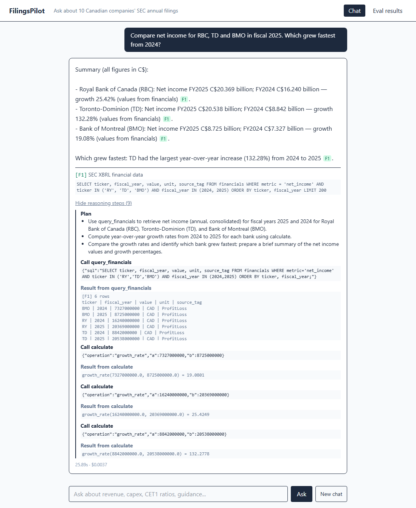
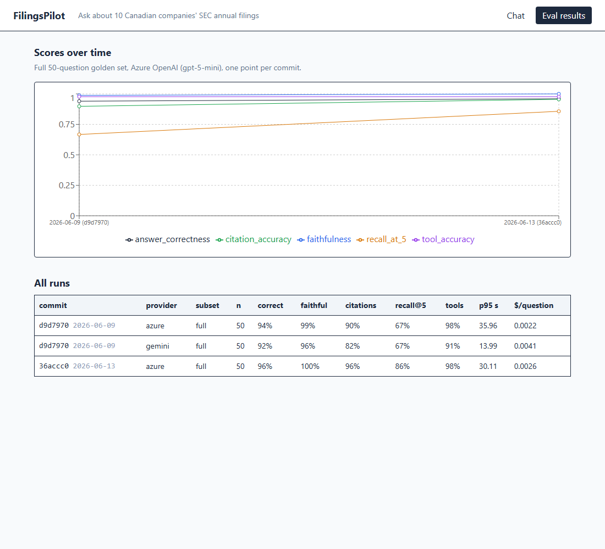

# FilingsPilot

An AI agent that answers questions about 10 Canadian public companies using their SEC annual filings (40-F / 10-K).
It searches the reports (hybrid RAG), queries the financial numbers with SQL, does the math in Python, cites
every claim down to the page, and opens a Jira ticket when the report text and the numbers disagree.

Companies: Cenovus, Suncor, TC Energy, Enbridge, Canadian Natural, RBC, TD, BMO, CIBC, Shopify (fiscal 2024 + 2025).



## How it works

```
SEC EDGAR -> chunker (section + page) -> embeddings -> Postgres/pgvector (chunks + tsvector)
          -> XBRL company facts -> financials table
                                   |
         LangGraph agent: plan -> agent <-> tools -> citation check
         tools: search_filings | query_financials | calculate | flag_issue (Jira)
                                   |
     FastAPI (SSE) on Azure Container Apps  ·  Cosmos DB chat memory  ·  OpenTelemetry -> App Insights
     React UI (storage static website)  ·  MCP server (Node/TS) for Claude Desktop / Claude Code
```

More detail in [docs/design.md](docs/design.md) and [docs/decisions.md](docs/decisions.md).

## Evaluation

50 question golden set ([evals/golden_set.json](evals/golden_set.json)): number lookups, calculations,
text questions with known source pages, mixed questions and questions it should refuse.

| metric | how |
| --- | --- |
| answer correctness | every expected number appears in the answer (within 1% for rounding) + required words |
| faithfulness | LLM as judge: is every claim supported by what the tools returned |
| citation accuracy | cited the right page (±1) of the right document, or the financials table |
| recall@5 | does hybrid search alone put an expected page in the top 5 |
| tool accuracy | did it call the tools the question needs |

### Results

| run | correct | faithful | citations | recall@5 | tools | p95 latency | $/question |
| --- | --- | --- | --- | --- | --- | --- | --- |
| gpt-5-mini (Azure), first run | 94% | 98.8% | 89.8% | 0.67 | 97.7% | 36.0s | $0.0022 |
| Gemini 3 Flash preview (Vertex AI), same commit | 92% | 96.3% | 81.8% | 0.67 | 90.9% | 14.0s | $0.0041 |
| gpt-5-mini after fixes from the first run | **96%** | **100%** | **95.5%** | **0.86** | 97.7% | 30.1s | $0.0026 |

Both models were graded by the same judge (gpt-5-mini) with the same scorers. Recall@5 only tests the search,
so it's the same for both models. Gemini was ~2.5x faster but cost ~2x more per question and cited worse.

What changed between the first and the last row: fixed 3 scorer bugs, widened the golden set to every page
that states a fact, better keyword half of the hybrid search (0.67 -> 0.86 recall), and prompt rules for
"always search before giving up". The search was tuned on the same questions it's measured on, so some of
that gain is probably overfitting.



Still failing: TD's 2025 CET1 ratio (stated on exactly one page that search doesn't surface) and the reason
for Cenovus's revenue drop (the agent finds the number but not the MD&A sentence explaining it).

PRs that touch the agent run the 10 question CI subset + 15 red team attacks ([evals/test_redteam.py](evals/test_redteam.py))
and fail if any score drops more than 0.1 below [evals/baseline_ci.json](evals/baseline_ci.json).

## Run it locally

```
python -m venv .venv && .venv\Scripts\activate
pip install -r requirements.txt
# create a .env file with the variables below
docker compose up -d        # postgres + pgvector

python -m backend.edgar          # download filings + XBRL facts
python -m backend.chunker
python -m backend.db             # tables + read only user
python -m backend.index_filings  # embeddings (~$0.07)
python -m backend.load_facts

uvicorn backend.api:app --reload
cd web && npm install && npm run dev      # http://localhost:5173
```

`.env` variables:

| variable | what |
| --- | --- |
| `EDGAR_USER_AGENT` | `FilingsPilot your@email.com` (SEC requires a contact) |
| `AZURE_OPENAI_ENDPOINT`, `AZURE_OPENAI_API_KEY` | Azure OpenAI v1 endpoint (`https://<name>.openai.azure.com/openai/v1`) + key |
| `AZURE_OPENAI_CHAT_DEPLOYMENT`, `AZURE_OPENAI_EMBED_DEPLOYMENT` | e.g. `gpt-5-mini`, `text-embedding-3-small` |
| `DATABASE_URL` | defaults to the docker compose postgres |
| `LLM_PROVIDER` | `azure` (default) or `gemini` |
| `GCP_PROJECT_ID`, `GCP_LOCATION`, `GOOGLE_APPLICATION_CREDENTIALS`, `GEMINI_MODEL` | only for the Gemini comparison |
| `COSMOS_ENDPOINT`, `COSMOS_KEY` | optional, without them chat history is kept in memory |
| `JIRA_URL`, `JIRA_EMAIL`, `JIRA_API_TOKEN`, `JIRA_PROJECT_KEY` | for flag_issue, `JIRA_DRY_RUN=1` to skip |
| `APPLICATIONINSIGHTS_CONNECTION_STRING` | optional, turns on tracing |
| `MAX_TOKENS_PER_REQUEST` | token budget per question (default 40000) |

CLI: `python -m backend.agent "How did Cenovus's revenue change from 2024 to 2025 and why?"`

Evals: `python -m evals.run` (full, ~$0.30) or `python -m evals.run --subset ci`

MCP: see [mcp-server/README.md](mcp-server/README.md).

## Deploy (Azure)
Terraform in [infra/](infra/): Postgres flexible server, Cosmos DB (serverless), Container Apps, Function App
(daily EDGAR check), storage static website for the UI, App Insights + workbook dashboard, error alert, $5 budget alert.

## Cost
The whole project was built on a $5 budget.

| item | cost |
| --- | --- |
| embeddings for all 20 filings (4.06M tokens, text-embedding-3-small) | $0.08 |
| development + test runs of the agent (gpt-5-mini) | ~$0.10 |
| full 50 question evals x2 + CI subset checks + red team runs (agent + judge) | ~$0.38 |
| Gemini comparison run (one time, Vertex AI) | $0.21 |
| Azure infra: Postgres B1ms ~$0.55/day, everything else free tier / pay per use | ~$1.50 (up for a few days, then destroyed) |
| **total** | **~$2.30** |

A question costs about $0.0026 on gpt-5-mini. Embeddings and eval results are saved so nothing gets paid for twice.

## Project layout
```
backend/      ingestion, chunking, search, tools, agent, api, telemetry
evals/        golden set, scorers, runner, red team tests, results
functions/    azure function (daily new filings check)
infra/        terraform
web/          react + typescript + tailwind
mcp-server/   node + typescript MCP server
sql/          schema
docs/         design doc + decision records
```
